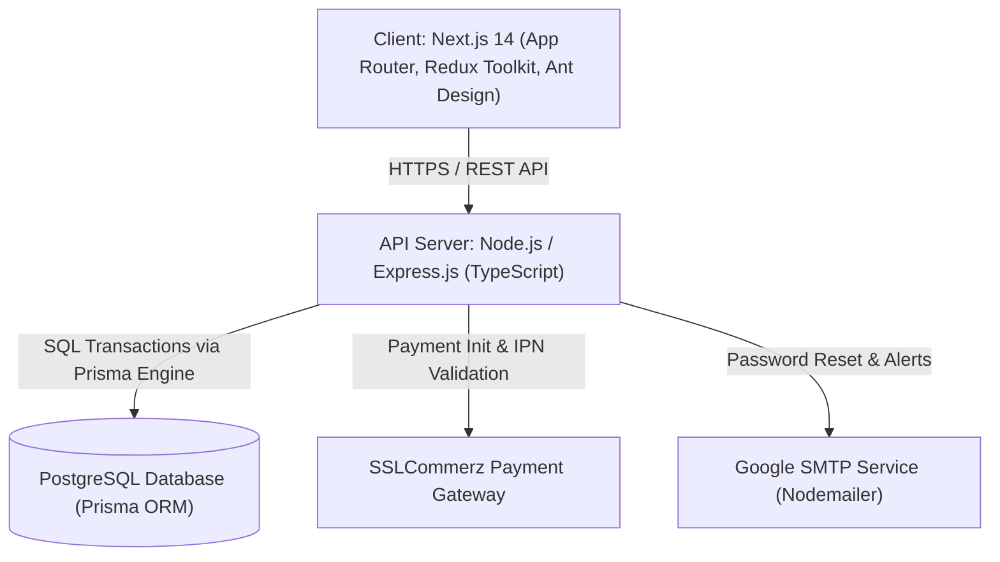
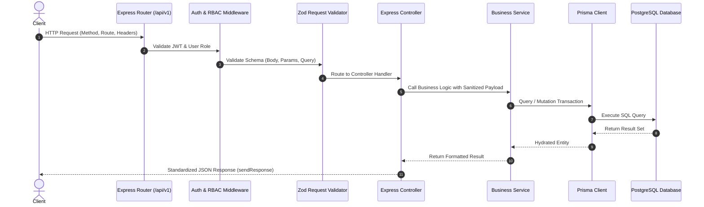
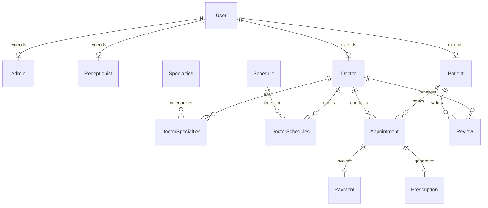

# Medico - System Architecture & Engineering Blueprint

This document details the layered architectural pattern, component boundaries, asynchronous flows, and database design of the **Medico** healthcare operations platform.

---

## 1. High-Level System Overview

Medico is a full-stack, decoupled healthcare management system consisting of a **Next.js 14 App Router** frontend, an **Express.js TypeScript** API server, **Prisma ORM**, and a relational **PostgreSQL** database:

---

## 2. Layered Application Architecture (Server)

The Express application follows a decoupled **Modular Layered Architecture**:

### Architectural Responsibilities:

1. **Routing Layer (`src/app/routes/`)**: Registers modular route groups under `/api/v1`.
2. **Middleware Layer (`src/app/middlewares/`)**:
   - `auth.ts`: Validates JWT bearer tokens and checks role access permissions.
   - `validateRequest.ts`: Enforces Zod contract validation before controller invocation.
   - `globalErrorHandler.ts`: Catches errors, maps Prisma/Zod exceptions to unified JSON formats.
3. **Controller Layer (`*.controller.ts`)**:
   - Unwraps request body, parameters, query, and session user.
   - Delegates business workflows to services.
   - Standardizes output using `sendResponse()`.
4. **Service Layer (`*.services.ts` / `*.service.ts`)**:
   - Encapsulates domain logic, financial calculations, state transitions, and third-party integrations (Nodemailer, SSLCommerz).
   - Manages Prisma database transactions (`prisma.$transaction`).
5. **Data Access Layer (`prisma/schema.prisma` & `src/app/shared/prisma.ts`)**:
   - Singleton Prisma client instance.
   - Type-safe models with relations, enum constraints, and cascade policies.

---

## 3. Database Entity Relationship Model

Medico's data model links users across four core domain models:

---

## 4. Key Architectural Subsystems

### A. Appointment Scheduling & Slot Locking
- Receptionists and Doctors generate bookable `Schedule` blocks (start time, end time, date).
- Associating schedules with doctors creates `DoctorSchedules`.
- When a Patient books an appointment, the schedule slot is claimed, status transitions to `SCHEDULED`, and a pending `Payment` record is created.

### B. Payment & SSLCommerz Integration
- Patients initiate payment for scheduled appointments via `POST /api/v1/payment/init-payment/:appointmentId`.
- The server generates a unique transaction ID (`tran_id`), calculates charges with fees, and redirects to SSLCommerz Gateway.
- Upon callback (`/success`, `/fail`, `/cancel`) or IPN validation, Prisma executes an atomic `$transaction` that marks the payment as `PAID` and updates the appointment status to `INPROGRESS`.
- Admins and Receptionists have authenticated access to verify offline/cash payments manually.

### C. Medical Prescription Issuance
- Doctors create prescriptions linked to completed or in-progress appointments.
- Rich clinical instructions, medicine schedules, and follow-up directives are persisted.
- Patients and Receptionists have read-only access to view and print invoices and prescriptions.
