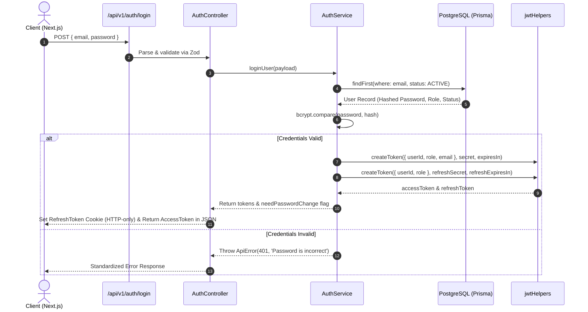

# Medico - Authentication & Authorization Architecture

This document outlines the authentication, authorization, token lifecycle, and Role-Based Access Control (RBAC) implementation for the **Medico** healthcare management platform.

---

## 1. Overview

Medico enforces strict role-based security across four core user roles:
- **`ADMIN`**: Full platform governance, staff onboarding, specialty configuration, and system oversight.
- **`RECEPTIONIST`**: Appointment scheduling, doctor availability management, patient record creation, and manual payment verification.
- **`DOCTOR`**: Appointment consultation, calendar management, and patient prescription issuance.
- **`PATIENT`**: Doctor discovery, appointment booking, prescription access, invoice review, and online payment.

Authentication is powered by **JSON Web Tokens (JWT)**, secure password hashing using **Bcrypt**, and middleware guards protecting Express routes.

---

## 2. Authentication Flow



---

## 3. Token Lifecycle & Specifications

| Token Type | Storage Strategy | Expiry | Claims / Payload | Purpose |
| :--- | :--- | :--- | :--- | :--- |
| **Access Token** | Client Memory / Secure State | `1d` / Short-lived | `{ userId, role, email }` | Authorizes authenticated API requests via `Authorization: Bearer <token>` |
| **Refresh Token** | Secure HTTP-Only Cookie | `365d` / Long-lived | `{ userId, role }` | Obtains new Access Tokens via `/api/v1/auth/refresh-token` without re-login |
| **Password Reset Token** | Ephemeral JWT via Email Link | `15m` / `1h` | `{ id: userId }` | Authorizes password reset for verified user identity |

---

## 4. Role-Based Access Control (RBAC) Guard

Express routes are protected using the `auth(...requiredRoles)` middleware:

```typescript
// server/src/app/middlewares/auth.ts
import { NextFunction, Request, Response } from 'express';
import httpStatus from 'http-status';
import { Secret } from 'jsonwebtoken';
import config from '../config';
import ApiError from '../errors/ApiError';
import { jwtHelpers } from '../helpers/jwtHelpers';

const auth = (...requiredRoles: string[]) =>
  async (req: Request, res: Response, next: NextFunction) => {
    try {
      const authHeader = req.headers.authorization;
      if (!authHeader) {
        throw new ApiError(httpStatus.UNAUTHORIZED, 'You are not authorized');
      }

      // Supports both "Bearer <token>" and raw token
      const token = authHeader.startsWith('Bearer ')
        ? authHeader.slice(7).trim()
        : authHeader.trim();

      if (!token) {
        throw new ApiError(httpStatus.UNAUTHORIZED, 'You are not authorized');
      }

      const verifiedUser = jwtHelpers.verifyToken(token, config.jwt.secret as Secret);
      req.user = verifiedUser;

      // Role authorization check
      if (requiredRoles.length && !requiredRoles.includes(verifiedUser.role)) {
        throw new ApiError(httpStatus.FORBIDDEN, 'Forbidden: Insufficient permissions');
      }

      next();
    } catch (error) {
      next(error);
    }
  };

export default auth;
```

---

## 5. Password Reset & IDOR Prevention

### Password Reset Flow:
1. **User Requests Reset**: Submits email to `POST /api/v1/auth/forgot-password`.
2. **Server Generates Token**: Signs a JWT containing `{ id: isUserExist.id }` with expiration.
3. **Email Dispatch**: Sends a secure reset link with query parameters `?id=<userId>&token=<resetToken>` via Nodemailer.
4. **Token Verification**: User submits `POST /api/v1/auth/reset-password` with `{ id, newPassword }` and `Authorization: <token>`.
5. **IDOR Mitigation**: The server verifies that the token is cryptographically valid **AND** that `verifiedToken.id === payload.id`. This prevents attacker token re-use against arbitrary target accounts.

---

## 6. Security Hardening Measures

- **No Plaintext Passwords**: All user passwords are encrypted using Bcrypt with a minimum salt factor of `12`.
- **Status Validation**: User status is checked on every login and token refresh to ensure `BLOCKED` or `DELETED` accounts cannot obtain sessions.
- **Strict CORS**: CORS origins are restricted to configured client domains with credentials support.
- **Cookie Security**: Refresh tokens are stored in `httpOnly`, `secure` (production), and `sameSite` cookies to prevent XSS exfiltration.
